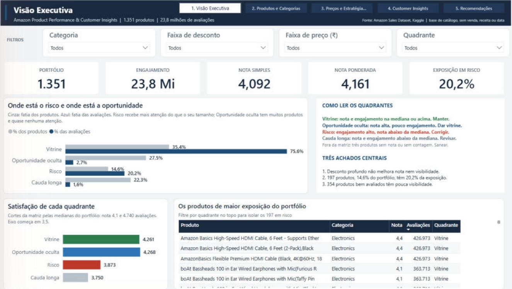
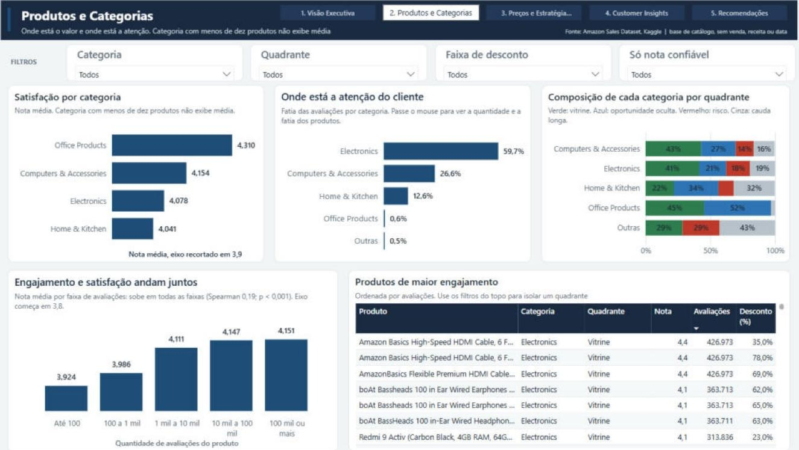
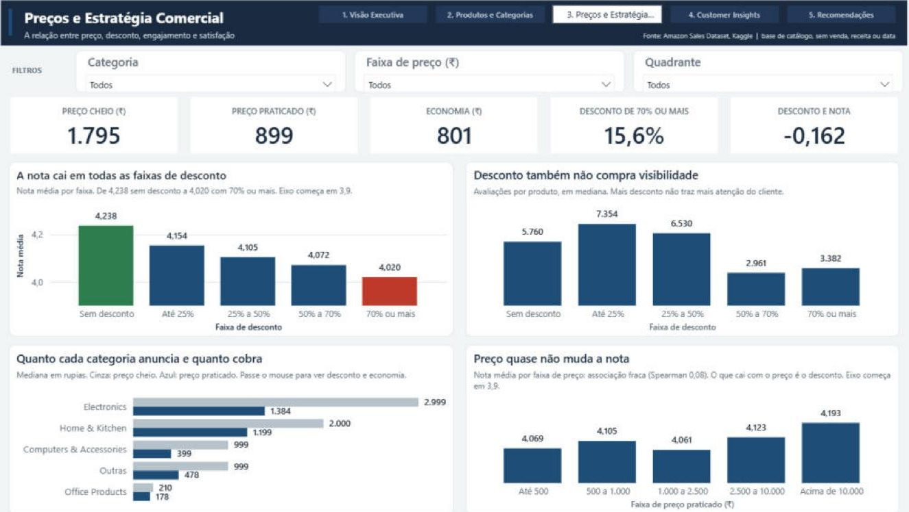
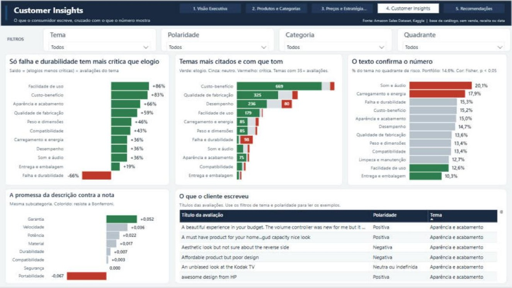
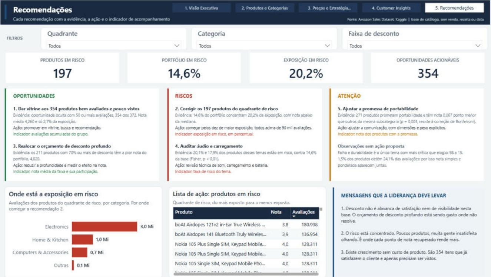

# Tech Challenge Fase 4: Amazon Product Performance & Customer Insights

Dashboard executivo em Power BI sobre o catálogo da Amazon Índia, construído para responder a uma pergunta da liderança de um e-commerce: **quais produtos, categorias e estratégias comerciais merecem maior atenção, e quais oportunidades os dados revelam?**

**Ana Paula Corrêa Galdino** · RM370461 · POSTECH Data Analytics (DTAT), FIAP

**Entregáveis do enunciado**

| Entregável | Onde está |
|---|---|
| Dashboard no Power BI (.pbix) | [`TechChallenge_Fase4_Dashboard.pbix`](TechChallenge_Fase4_Dashboard.pbix) |
| Vídeo executivo, até 7 minutos | [Apresentação](https://youtu.be/f8-K8QNITyQ) |

---

## 1. O problema

A liderança quer entender a relação entre **preço, desconto, engajamento e satisfação do cliente** para decidir onde investir, o que corrigir e o que promover.

Usei a base [Amazon Sales Dataset](https://www.kaggle.com/datasets/karkavelrajaj/amazon-sales-dataset), do Kaggle, indicada no enunciado: 1.465 linhas, 1.351 produtos distintos e 23,8 milhões de avaliações acumuladas.

Uma delimitação guiou todo o trabalho: a base é um retrato de catálogo. Não tem venda, pedido, receita nem data. Por isso não apresento faturamento, e a quantidade de avaliações é tratada como medida de atenção do cliente, nunca de volume vendido.

## 2. O que os dados mostram

| Achado | Número |
|---|---|
| Desconto não compra satisfação | a nota cai nas cinco faixas de desconto, de 4,238 sem desconto a 4,020 com 70% ou mais |
| Desconto também não compra visibilidade | mediana de 5.760 avaliações sem desconto, contra 3.382 com 70% ou mais |
| O risco está concentrado | 14,6% dos produtos, com nota abaixo da mediana, recebem 20,2% de toda a atenção |
| Existe crescimento sem custo de produto | 354 produtos bem avaliados recebem só 2,7% da atenção |
| Engajamento e satisfação andam juntos | a nota sobe de 3,924 para 4,151 conforme cresce a quantidade de avaliações |
| O texto confirma o número | produtos que falam de som e áudio estão 20,1% no quadrante de risco, e de carregamento, 17,9% |
| O que o cliente critica | falha e durabilidade é o único tema com mais crítica que elogio: 98 contra 15 |
| A promessa da descrição pesa | quem promete portabilidade tem nota 0,067 ponto menor que a própria subcategoria |

Todas as relações são associações. Sem dado ao longo do tempo, nenhuma delas é tratada como causa.

## 3. O dashboard

Cinco telas, na estrutura sugerida pelo enunciado, com barra de navegação no topo, filtros que recortam a tela inteira e números de apoio ao passar o mouse.

### Tela 1. Visão Executiva
Os cinco indicadores do portfólio e a matriz de engajamento contra satisfação, que separa o portfólio em Vitrine, Oportunidade oculta, Risco e Cauda longa.

### Tela 2. Produtos e Categorias
Satisfação e atenção por categoria, composição de cada categoria por quadrante e a relação entre quantidade de avaliações e nota.

### Tela 3. Preços e Estratégia Comercial
Preço cheio, preço praticado e desconto, e o efeito do desconto e do preço sobre nota e engajamento.

### Tela 4. Customer Insights
O que o cliente escreve: elogio e crítica por tema, temas ligados ao quadrante de risco e o efeito das promessas da descrição sobre a nota.

### Tela 5. Recomendações
Cinco recomendações, cada uma com evidência, ação e indicador de acompanhamento, e as mensagens que a liderança deve levar.

## 4. Como construí

**Preparação dos dados, no Power Query.** A consulta `fProdutos` lê a base bruta e aplica, em passos nomeados:

- conversão de preço, desconto e contagem, que chegam como texto ("₹1,099", "64%");
- deduplicação por produto, mantendo a linha de maior contagem de avaliações;
- quebra da categoria em níveis, com as palavras coladas separadas;
- faixas de preço, desconto e engajamento, com ordem de exibição;
- sinalizadores de qualidade, como nota confiável (50 avaliações ou mais);
- matriz de quadrantes pelas medianas do portfólio (nota 4,1 e 4.740 avaliações).

**Camada de texto, em Python.** A classificação de temas e de polaridade dos comentários, que o Power BI não faz nativamente, foi feita em Python com o VADER, ajustado ao vocabulário de e-commerce e validado em uma amostra de 120 títulos rotulados à mão (81,7% de acerto).

**Medidas e indicadores.** 42 medidas DAX, com guardas contra conclusões frágeis: categoria com menos de dez produtos não exibe média, tema com menos de 35 avaliações fica fora de ranking, e a nota simples aparece sempre ao lado da ponderada.

**Conferência.** Todos os números do dashboard foram recalculados de forma independente, a partir da base bruta, em 121 checagens.

## 5. Recomendações para o negócio

1. Dar vitrine aos 354 produtos bem avaliados e pouco vistos.
2. Corrigir os 197 produtos do quadrante de risco, começando pelos dez de maior exposição.
3. Realocar o orçamento de desconto profundo, que não entrega nem satisfação nem atenção.
4. Auditar a qualidade técnica de áudio e carregamento.
5. Ajustar a comunicação de portabilidade, com peso e dimensões explícitos.

## 6. Como abrir

Baixe o arquivo `TechChallenge_Fase4_Dashboard.pbix` e abra no Power BI Desktop. Os dados já estão dentro do arquivo, então não é preciso atualizar. Use a barra no topo para navegar entre as telas.

## Ferramentas

Power BI Desktop (Power Query e DAX) · Python (pandas, scipy, VADER)
